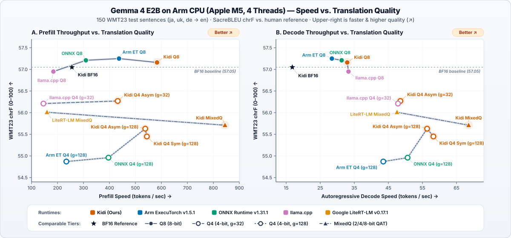

# Kidi <a href="docs/kidi-logo.png"></a>

**Fast, self-contained C++23 on-device AI runtime and app suite for chat, vision, speech transcription, speech synthesis, and 500-language translation.**

Kidi (*"spark"* in Kannada) runs modern generative AI models locally on your hardware — from **Arm & x86 CPUs**, **Apple Metal**, **NVIDIA CUDA**, **Vulkan**, and **Qualcomm QNN NPUs** to **Android phones**, **Desktop apps**, and **WebAssembly / WebGPU browsers** — without requiring PyTorch, Hugging Face `transformers`, or cloud APIs.

[Why Kidi?](#why-kidi) | [Benchmarks](#performance-highlights) | [Models & Backends](#supported-models--backends) | [Quick Start](#quick-start) | [CLI Tasks](#command-line-tasks) | [Desktop, Web & Android Apps](#applications) | [Ecosystem & Citation](#companion-projects--publications) | [Developer Guide](README-dev.md)

---

## Why Kidi?

- **Batteries-Included Single Binary (`~7.6 MiB`):** Zero runtime dependency on PyTorch, Transformers, OpenCV, Pillow, or Python. A single static binary compiles in our purpose-built C++ libraries:
  - **Compute & Shaders ([`ynnpack-dev`](https://github.com/thammegowda/ynnpack-dev)):** Our extended fork of YNNPACK (`ARM64` NEON/DOTPROD/SME2, `x86` AVX2/AVX-512, `Wasm` SIMD128, CUDA) + embedded Apple Metal kernels
  - **Tokenization & Text ([`tokenizerspp`](https://github.com/thammegowda/tokenizerspp)):** Native C++ Hugging Face `tokenizer.json` engine, Unicode (`uni-algo`), regex (`RE2`), G2P phonemizer, and linguistic sentence splitter
  - **Vision & Image Codecs ([`tahoma-vision`](https://github.com/thammegowda/tahoma-vision) & [`pigzpp`](https://github.com/thammegowda/pigzpp)):** SIMD-accelerated **JPEG (`libjpeg-turbo`)**, **PNG ([`pigzpp`](https://github.com/thammegowda/pigzpp) + `zlib-ng`)**, and PPM decoding + vision tensor preprocessing
  - **Audio & Speech:** WAV PCM I/O, Whisper log-Mel spectrogram frontend, and neural vocoders (Higgs Audio 2 / Kokoro)
  - **Checkpoints & Formats:** Zero-copy `mmap` Safetensors, GGUF/GGML, YAML (`yaml-cpp`), JSON (`nlohmann/json`), and parallel gzip ([`pigzpp`](https://github.com/thammegowda/pigzpp) / `zlib-ng`)
  - **Desktop Server & UI ([`liteapp`](https://github.com/thammegowda/liteapp)):** Embedded C++ HTTP + WebSocket loopback server, EPUB/ZIP virtual filesystem, and bundled web/Android UI bridge (`kidi-app`)
- **State-of-the-Art Edge CPU & GPU Speed:** Custom ARM64 SME2 and fused zero-copy NEON `sdot` kernels (`BlockwiseInt4Linear`), graph capture/replay, and `mmap`-backed weight streaming deliver faster prefill, faster decode, and lower RAM usage than ExecuTorch, ONNX Runtime, `llama.cpp`, and LiteRT-LM.
- **High-Fidelity Low-Bit Quantization:** Built on findings from our [**WMT 2026 LLM compression paper**](https://aclanthology.org/2026.wmt-main.136/) (*Quantize, Qualify, Rerank: A Recipe for Compressing LLMs Without Losing Quality*) and [**engineering blog post**](https://gowda.ai/posts/2026/08/llm-fast-inference/). Supports native mixed 2/4/8-bit QAT checkpoints, blockwise symmetric INT4/INT8, and **blockwise asymmetric INT4 (`g=128` and `g=32`) with 11-step MSE outlier clipping** that recovers near-BF16 translation quality at 4-bit memory footprints.
- **One Engine, Every Surface:** Use the CLI and Python package for scripting, or launch the **Desktop App**, **Android App**, or **WebAssembly / WebGPU Browser App** for streaming chat, continuous voice conversations, camera/photo Q&A, and side-by-side bilingual EPUB book reading with read-aloud narration.

---

## Performance Highlights

### Gemma 4 E2B (`google/gemma-4-E2B-it`) on Arm CPU (Apple M5, 4 Threads, Batch 1)

Measured against **Arm ExecuTorch v1.5.1** (`XNNPACK + KleidiAI`), **ONNX Runtime v1.31.1** (`MLAS + KleidiAI`), **`llama.cpp`** (`GGML + KleidiAI`), and **Google LiteRT-LM v0.17.1** (`XNNPACK`) across both throughput (`tokens/s`) and 150-sentence WMT23 (`ja, uk, de -> en`) translation quality (`chrF` vs. human reference translations). Full methodology and 4-table breakdown in [`benchmarks/gemma4/arm/README.md`](benchmarks/gemma4/arm/README.md):

<p align="center">
  
</p>

- **Dominates the 4-bit & 8-bit Pareto frontier on both Prefill and Decode:**
  - **4-bit QAT (`2.29 GiB`):** Kidi reaches **844.8 tok/s prefill** (**5.29x faster** than Google LiteRT-LM at `159.7 tok/s`) and **68.6 tok/s decode** (**1.44x faster** than LiteRT-LM at `47.5 tok/s`).
  - **4-bit `g=128` (`2.27 GiB`):** On matched weights, Kidi runs **2.32x faster on prefill** (`544.1` vs. `234.1 tok/s`) and **1.34x faster on decode** (`58.2` vs. `43.5 tok/s`) than Arm ExecuTorch in **1.44 GiB RAM**, and **1.37x faster on prefill** (`544.1` vs. `396.3 tok/s`) and **1.15x faster on decode** (`58.2` vs. `50.7 tok/s`) than ONNX Runtime.
  - **4-bit `g=32` (`2.47 GiB`):** Kidi's asymmetric INT4 + MSE outlier clipping reaches **`56.27` `chrF (ref)` / `87.79` `chrF (bf16)`** at **432.0 tok/s prefill** (**2.96x faster** than `llama.cpp` `Q4_0`) and **48.5 tok/s decode** while using **2.30x less RAM** (`1.69 GiB` vs. `3.88 GiB`).
  - **8-bit (`4.37 GiB`):** Kidi reaches **583.1 tok/s prefill** (**1.33x faster** than Arm ExecuTorch, **1.88x faster** than ONNX Runtime, and **3.16x faster** than `llama.cpp` `Q8_0`) at near-lossless BF16 quality (`57.16` `chrF`).
- **CUDA Graph Pipelining:** On an NVIDIA RTX A4000 (2,322-token prompt, BF16), Kidi reaches **11,285.9 tok/s prefill** (**1.40x faster** than compiled `vLLM` at `8,062.7 tok/s`) and **64.4 tok/s decode** (see [`benchmarks/README.md`](benchmarks/README.md)).

---

## Supported Models & Backends

### Models & Modalities

| Model Family | Tasks | Highlights |
|---|---|---|
| **Gemma 4 (`E2B-it`, `E4B-it`)** | Chat, JSONL Generation, Vision (Photo Q&A) | Native QAT (mixed 2/4/8-bit), BF16, Per-Channel INT8, and Group-32/128 Symmetric & Asymmetric INT4 with tied embeddings |
| **Qwen 3** | Chat & Text Generation | Grouped-query attention, SwiGLU, RMSNorm, and quantized linear execution |
| **Whisper (`Tiny`, `Base`, `Small`, `Large-v3`, `Turbo`)** | Speech-to-Text (`transcribe`) & Speech-to-English (`translate`) | Loads directly from Hugging Face checkpoints; automatic INT8 weight caching and 30s windowed long-audio streaming |
| **OmniVoice** | Multilingual Text-to-Speech (`synthesize`) | 600+ MB INT8 package with controllable voice attributes (`gender`, `age`, `pitch`, `accent`, `style`) and consistent long-form narrator conditioning |
| **Kokoro-82M** | US-English Text-to-Speech (`synthesize`) | Compact INT8 model with bundled offline Misaki pronunciation lexicon and selectable voice packs |
| **RTG Transformer** | Machine Translation (`translate`) | Supports the public [500-language-to-English (`rtg-500eng-v1`)](https://huggingface.co/thammegowda/rtg-500eng-v1) model |

### Hardware Acceleration Backends

| Backend | Flag / Target | Supported Platforms & Notes |
|---|---|---|
| **[`ynnpack-dev`](https://github.com/thammegowda/ynnpack-dev) + ARM64 NEON/SME2 / x86 AVX** | `--backend ynnpack` | Portable default on macOS, Linux, Windows, Android (`arm64`), and WebAssembly SIMD |
| **Apple Metal (MPS)** | `--backend mps` | Default on Apple Silicon macOS for supported chat and OmniVoice TTS models |
| **NVIDIA CUDA** | `--backend cuda:0` | Opt-in CUDA 13 + cuBLAS backend with asynchronous graph capture/replay pipelining |
| **Vulkan** | `--backend vulkan` | Cross-platform GPU compute used on Android and desktop |
| **Qualcomm QNN (Hexagon NPU)** | Android / Snapdragon | Step-compiled NPU graph execution for mobile inference |
| **WebAssembly + WebGPU** | Browser (`make wasm`) | Runs entirely in Chrome/Edge/Firefox/Safari with IndexedDB/OPFS model caching |

---

## Quick Start

Install from Git in a Python 3.12+ virtual environment (requires Git and a C++23 compiler such as Xcode Command Line Tools on macOS; **no PyTorch or Transformers needed**):

```bash
python3.12 -m venv .venv
source .venv/bin/activate
python -m pip install -v "kidi[hf] @ git+https://github.com/thammegowda/kidi.git@main"

# Launch interactive streaming chat (downloads ~2.49 GB once and caches locally)
python -m kidi chat -m @google/gemma-4-E2B-it-qat-mobile-transformers
```

- **Select a backend:** Metal is chosen automatically on Apple Silicon when supported; pass `--backend ynnpack` for CPU or `--backend cuda:0` on CUDA builds.
- **Control memory:** Native defaults use a 16,384-token context and up to 8,192 output tokens. For tighter RAM budgets, pass `--context-size 2048 --max-new-tokens 256`.
- **Standalone C++ binary:** Build `build-release/kidi` via CMake (`make app` or `cmake --preset release`) to run local checkpoints with zero Python dependency. See the [Getting Started Guide](docs/getting-started.md) and [Developer Guide](README-dev.md).

---

## Command-Line Tasks

### 1. Interactive Chat & Batch JSONL Generation (`chat` / `generate`)

In `kidi chat`, replies stream token-by-token and report throughput, TTFT, and memory usage after each turn (commands: `/clear`, `/system <prompt>`, `/multiline`, `/send`, `/help`, `/exit`).

For scripted pipelines, `kidi generate` streams JSONL requests to JSONL responses:

```bash
printf '%s\n' '{"messages":[{"role":"user","content":"Explain binary search in three bullet points."}],"max_tokens":128}' | \
  kidi generate -m @google/gemma-4-E2B-it-qat-mobile-transformers
```

### 2. Speech Transcription & Translation (`transcribe`)

Whisper models load directly from Hugging Face (16 kHz mono/multichannel WAV input) and cache a native INT8 layout on first load:

```bash
# Transcribe speech (use --language en/es/de/ja/hi or auto; add --task translate for English output)
python -m kidi transcribe \
  --model @openai/whisper-large-v3-turbo \
  --in recording-16k.wav \
  --language auto \
  --out transcript.txt
```

### 3. Text-to-Speech Synthesis (`synthesize`)

Synthesize natural speech using **OmniVoice** (multilingual with voice design attributes) or **Kokoro-82M** (compact US English):

```bash
# OmniVoice: convert once to INT8 (~618 MB), then synthesize on CPU, Metal (--backend mps), or Vulkan
python -m pip install '.[convert,hf]'
SOURCE="$(hf download k2-fsa/OmniVoice)"
python -m kidi.converters.omnivoice "$SOURCE" .cache/omnivoice-int8

build-release/kidi synthesize \
  --model .cache/omnivoice-int8 \
  --text 'Hello from Kidi.' \
  --language English \
  --voice gender=female --voice 'age=young adult' --voice accent=british \
  --out hello.wav
```

```bash
# Kokoro-82M: convert with selected voice pack(s) and synthesize
SOURCE="$(hf download hexgrad/Kokoro-82M config.json kokoro-v1_0.pth voices/af_heart.pt README.md VOICES.md)"
python -m kidi.converters.kokoro "$SOURCE" .cache/kokoro-int8 --voices af_heart

build-release/kidi synthesize \
  --model .cache/kokoro-int8 \
  --text 'Hello world.' \
  --language English \
  --voice name=af_heart --voice speed=1.0 \
  --out kokoro.wav
```

> **Note on model licenses:** Kokoro-82M and Misaki are Apache-2.0. Pretrained OmniVoice weights are **CC-BY-NC** (non-commercial) and bundle the Higgs Audio 2 decoder; review the generated `NOTICE` file before redistributing converted checkpoints.

### 4. 500-Language Machine Translation (`translate`)

Translate text from 500 languages into English using the public [RTG 500 model](https://huggingface.co/thammegowda/rtg-500eng-v1):

```bash
kidi translate -m @thammegowda/rtg-500eng-v1 -i input.txt -o output.txt --beam-size 1
```

---

## Applications

Kidi shares a unified responsive UI across Desktop, Browser, and Android:

### 1. Native Desktop App ([`desktop/README.md`](desktop/README.md))

Combines the native C++ inference process with an embedded [`liteapp`](https://github.com/thammegowda/liteapp) interface over a capability-protected local loopback server (no Node.js required):

```bash
make app
build-release/kidi-app examples/kidi-app.yaml
```

- **Streaming Chat & Continuous Voice Turns:** Live Markdown rendering, syntax-highlighted code blocks, VAD-triggered Whisper dictation, and automatic TTS read-aloud replies.
- **Bilingual EPUB Reader & Narrator:** Import EPUB books, translate chapters side-by-side in the background with persistent paragraph-level caching, and listen to synchronized read-aloud narration in either the source or target language.

### 2. WebAssembly & WebGPU Browser App ([`web/README.md`](web/README.md))

Runs Gemma 4 E2B and Whisper dictation **100% inside the browser** (Chrome, Edge, Firefox, Safari) with WebGPU acceleration and persistent browser-cached weights (`make wasm`). Includes the full chat interface, microphone dictation, and bilingual EPUB Reader.

### 3. Android App ([`android/README.md`](android/README.md))

Packages the [`liteapp`](https://github.com/thammegowda/liteapp) interface with Kidi's ARM64 JNI runtime for Android 10+ phones:
- Supports offline streaming chat, **camera & photo Q&A** (Gemma 4 vision), Whisper dictation, OmniVoice read-aloud, and the bilingual EPUB Reader.

---

## Companion Projects & Publications

Kidi is built atop modular, open-source C++ libraries and quantization research:

| Project / Publication | Description |
|---|---|
| **[`ynnpack-dev`](https://github.com/thammegowda/ynnpack-dev)** | Custom fork of YNNPACK with low-bit LLM operators, ARM64 NEON/DOTPROD/SME2, x86 AVX2/AVX-512, WebAssembly SIMD128, and CUDA kernels |
| **[`tokenizerspp`](https://github.com/thammegowda/tokenizerspp)** | Fast, standalone C++ Hugging Face `tokenizer.json` implementation (BPE, Unigram, WordPiece, pre-tokenizers, and chat templates) |
| **[`tahoma-vision`](https://github.com/thammegowda/tahoma-vision)** | Lightweight SIMD-accelerated C++ vision library for JPEG (`libjpeg-turbo`), PNG ([`pigzpp`](https://github.com/thammegowda/pigzpp) + `zlib-ng`), PPM, and image preprocessing |
| **[`pigzpp`](https://github.com/thammegowda/pigzpp)** | Modern C++ parallel gzip/deflate compression and decompression library built on `zlib-ng` |
| **[`liteapp`](https://github.com/thammegowda/liteapp)** | Zero-Node.js C++23 cross-platform application framework with an embedded HTTP/WebSocket server, ZIP/EPUB virtual filesystem, and web/Android transport bridge |
| **[WMT 2026 Paper](https://aclanthology.org/2026.wmt-main.136/)** | *Quantize, Qualify, Rerank: A Recipe for Compressing LLMs Without Losing Quality* (Thamme Gowda, WMT 2026, pp. 1991–1998) |
| **[Technical Blog Post](https://gowda.ai/posts/2026/08/llm-fast-inference/)** | Deep dive into Kidi's blockwise INT4 quantization, 11-step MSE outlier clipping, and ARM64 CPU roofline optimizations |

### Citation

If you use Kidi or its quantization recipes in your research or engineering work, please cite our [WMT 2026 paper](https://aclanthology.org/2026.wmt-main.136/):

```bibtex
@inproceedings{gowda-2026-quantize,
    title = "Quantize, Qualify, Rerank: A Recipe for Compressing {LLM}s Without Losing Quality",
    author = "Gowda, Thamme",
    booktitle = "Proceedings of the Eleventh Conference on Machine Translation",
    month = oct,
    year = "2026",
    address = "Budapest, Hungary",
    publisher = "Association for Computational Linguistics",
    url = "https://aclanthology.org/2026.wmt-main.136/",
    doi = "10.18653/2026.wmt-main.136",
    pages = "1991--1998"
}
```

---

## Documentation & Links

- **[Getting Started Guide](docs/getting-started.md):** Detailed setup, offline caching, and CLI walkthroughs.
- **[Arm CPU Benchmark Suite](benchmarks/gemma4/arm/README.md):** Gemma 4 E2B comparisons against Arm ExecuTorch + KleidiAI, ONNX Runtime, `llama.cpp`, and Google LiteRT-LM.
- **[Benchmarks Overview](benchmarks/README.md):** Native CPU and NVIDIA CUDA vs. vLLM benchmarks.
- **[Developer Guide](README-dev.md):** CMake presets, C++ architecture, checkpoint converters, WebAssembly/Android builds, and test suites.
- **[Android Privacy Policy](android/PRIVACY.md) | [Android Terms of Use](android/TERMS.md)**

> **AI Notice:** Kidi is experimental software. AI-generated responses, photo interpretations, translations, and speech transcriptions can contain errors — always verify important information independently.