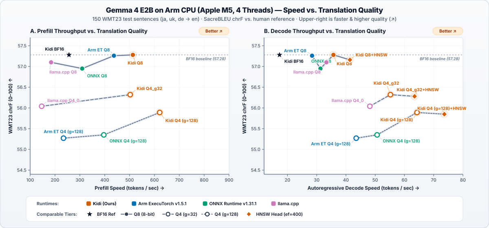

# Kidi <a href="docs/kidi-logo.png"></a>

**A local AI agent and inference engine in one C++ binary.** `kidi agent` chats, reads your code, edits files and
runs commands with open models on your own NVIDIA GPU, Apple Silicon or CPU: no cloud API, no API keys, and no PyTorch
or Python ML stack.

Kidi (*"spark"* in Kannada) also serves an OpenAI-compatible API to other tools, and runs speech, translation and
vision models in desktop, browser and Android apps.

[Quick Start](#quick-start) | [Kidi Agent](#kidi-agent) | [Models & Hardware](#models--hardware) |
[OpenAI-Compatible Server](#openai-compatible-server) | [Performance](#performance) | [Also in Kidi](#also-in-kidi) |
[Developer Guide](README-dev.md)

---

## Quick Start

Install into a Python 3.12+ virtual environment. Pip compiles Kidi from source, so you need Git and a C++23 compiler
(Xcode Command Line Tools on macOS); PyTorch and Transformers are not needed.

```bash
python3.12 -m venv .venv
source .venv/bin/activate
python -m pip install -v "kidi[hf] @ git+https://github.com/thammegowda/kidi.git@main"

cd /path/to/your/project
kidi agent                                       # Gemma 4 E2B mobile QAT: ~2.5 GB download, fits a laptop
kidi agent -m @thinkingmachines/Inkling-2-Mini   # reasoning and tool calls; needs much more memory (see below)
```

The pip package runs on CPU and Apple Metal. For NVIDIA GPUs, build the static CUDA binary on Linux with the CUDA 13+
toolkit ([CUDA build guide](README-dev.md#cuda)):

```bash
git clone --recurse-submodules https://github.com/thammegowda/kidi.git && cd kidi
make release-cuda
build-release-cuda/kidi agent -m @thinkingmachines/Inkling-2-Mini --workspace /path/to/your/project
```

Models download once into `~/.cache/kidi/model-hub/`. The first `kidi agent` starts a background inference server;
later sessions with the same model reuse it, and it exits 10 minutes after the last session closes. The
[Getting Started Guide](docs/getting-started.md) covers memory settings, offline use and per-backend details.

---

## Kidi Agent

`kidi agent` is a terminal agent backed by Kidi's own inference server, so the model, the tools and the UI all run
on your machine.

- **Works in your project, with your approval.** The agent reads and lists files, writes files, creates directories,
  and runs shell commands such as builds, tests and searches. By default it asks before every write or command:
  approve once (**y**), for the rest of the session (**a**), or deny (**n**).
- **Long sessions stay fast.** The server keeps the previous request's KV cache, so each turn prefills only the new
  messages. Before the context fills, the agent compacts older turns into a handoff summary using exact token counts
  from the server; `/context` shows usage and `/compact` compacts on demand.
- **Sized to your hardware.** The server sizes the context window from the device memory left after loading weights.
  Inkling-2-Mini keeps its native NVFP4/MXFP8 experts on CUDA, and uses compact VQ weights on Apple Metal and INT8 on
  CPU.
- **Faster code edits.** `--prompt-lookup` speculative decoding drafts tokens by copying matching text from the prompt
  and history, with no second model (Inkling-2 on CPU, greedy decoding).
- **Full terminal UI.** Streaming replies, line editing, history, multiline paste, colored tool activity, and a status
  bar with context usage, token speed and prefill time. Ctrl-C cancels a turn, including a running command.
- **Scriptable and configurable.** `-p "task"` runs one task and exits. Prompts, sampling and the tool registry come
  from [`agent.yaml`](kidi-agent/agent.yaml) (replace it with `--config`); each tool binds to a compiled handler, so
  renaming a tool cannot widen what it can do. Sessions are saved as private local JSONL transcripts (`--no-save`
  turns this off).
- **Embeddable.** The agent loop, YAML configuration and workspace tools are C++ libraries (`kidi::agent`) that apps
  can link and extend with their own tools.

| `--permissions` | Tools offered | File writes | Commands |
| --- | --- | --- | --- |
| `none` | None (plain chat) | - | - |
| `read-only` | Read and list files | Denied | Denied |
| `ask` (default) | All | Ask | Ask |
| `workspace-write` | All | Allowed | Ask |
| `full-access` | All | Allowed | Allowed |

```bash
kidi agent --permissions none --system "Answer in French."               # plain chat
kidi agent --permissions read-only -p "Explain how this project is organized"
kidi agent --permissions workspace-write                                 # edit freely, ask before commands
```

File tools reject absolute paths, `..`, `.git` and symlinks, but **permissions are not an OS sandbox**: approved
commands run with your privileges. On Linux, [tools/sandbox](tools/sandbox/README.md) confines the standalone
`kidi-agent` client to one workspace with Landlock. See the [Kidi Agent guide](kidi-agent/README.md) for shell
commands, configuration and the standalone client.

---

## Models & Hardware

| Model | Use | Notes |
|---|---|---|
| **Inkling 2 Mini** (`@thinkingmachines/Inkling-2-Mini`) | Agent with reasoning and tool calls | Looped 24-layer MoE with 128 experts (top-8). CUDA keeps native NVFP4/MXFP8 experts and fits under 24 GiB at an 8K context; sliding-window layers use small ring caches, so a 48 GB GPU holds a ~690K-token context (its full 1M tokens with `--kv-cache-precision int8`). Apple Metal uses compact VQ weights; CPU converts to INT8 once and caches the result. |
| **Gemma 4** (`E2B-it`, `E4B-it`) | Agent default (E2B mobile QAT), chat, photo Q&A | Native mixed 2/4/8-bit QAT checkpoints load without conversion; BF16 checkpoints can also run as INT8 or INT4 |
| **Qwen 3** | Chat and text generation | Also the language backbone of OmniVoice |
| **Whisper**, **OmniVoice**, **Kokoro-82M**, **RTG** | Speech recognition, speech synthesis, translation | See [Also in Kidi](#also-in-kidi) |

| Backend | `--backend` | Notes |
|---|---|---|
| NVIDIA CUDA | `cuda[:INDEX]` | Linux, Ampere or newer; native [`kidi-ops`](kidi-ops/README.md) kernels with graph capture/replay in a static CUDA 13 binary (`make release-cuda`) |
| Apple Metal | `mps` | Apple Silicon macOS |
| CPU ([`ynnpack-dev`](https://github.com/thammegowda/ynnpack-dev)) | `ynnpack` | Arm64 NEON/DOTPROD/SME2 and x86-64 AVX2/AVX-512 on macOS, Linux, Windows and Android |
| Vulkan, Qualcomm QNN NPU, WebGPU | `vulkan`, `npu` | Android and browser apps; Vulkan is experimental on desktop |

`--backend auto` (the default) picks CUDA, then Metal, then CPU. `kidi agent` is built on Linux and macOS.

---

## OpenAI-Compatible Server

`kidi serve` runs the agent's engine as an OpenAI-compatible server for other agents, editors and scripts:
`/v1/chat/completions` (streaming or not) with `tools`, parsed `reasoning_content` and `tool_calls`,
`reasoning_effort`, `chat_template_kwargs`, and `temperature`/`top_p`/`top_k` sampling. One engine thread owns the
model and reuses cached prompt prefixes across turns.

```bash
kidi serve -m @thinkingmachines/Inkling-2-Mini --port 18097    # http://127.0.0.1:18097/v1
```

The server listens on `127.0.0.1` and has no API keys or TLS; use it only with trusted local clients. For batch jobs,
`kidi generate` maps JSONL requests to JSONL responses. See
[Scripted Generation and the Server API](docs/getting-started.md#scripted-generation-and-the-server-api).

---

## Performance

<p align="center">
  
</p>

- **Arm CPU:** For Gemma 4 E2B at Q8 and Q4 on an Apple M5 (4 threads, batch 1), Kidi leads Arm ExecuTorch, ONNX
  Runtime and `llama.cpp` in both prefill and decode throughput while matching or exceeding their generation quality
  (`chrF` on WMT23 translation). Speculative decoding with an assistant model and an HNSW output head add further
  decode speedups without losing quality. See the [Arm CPU benchmark](benchmarks/gemma4/arm/README.md).
- **CUDA:** Native kernels with graph capture/replay. Results depend on the GPU, model and precision; the
  [H100 comparison](benchmarks/cuda/2026-11-20-e4b-q8-h100-gpu7.md) shows that vLLM can be faster.
- **One small binary:** Kidi links its libraries into one executable with no runtime dependency on PyTorch,
  Transformers, OpenCV or Python. A stripped Linux x86-64 CPU Release CLI, agent included, measured 10.8 MiB in
  November 2026; `-DKIDI_BUILD_AGENT=OFF` omits the agent.
- **Low-bit quantization:** Blockwise asymmetric INT4 with MSE outlier clipping recovers near-BF16 quality at 4-bit
  memory footprints ([WMT 2026 paper](https://aclanthology.org/2026.wmt-main.136/),
  [blog post](https://gowda.ai/posts/2026/08/llm-fast-inference/)).

---

## Also in Kidi

- **Speech recognition:** Whisper transcription and speech-to-English translation with `kidi transcribe`
  ([guide](docs/getting-started.md#whisper-transcription)).
- **Speech synthesis:** OmniVoice (multilingual, with voice design) and Kokoro-82M with `kidi synthesize`
  ([guide](docs/getting-started.md#text-to-speech)).
- **Translation:** 500 languages to English with the [RTG 500 model](https://huggingface.co/thammegowda/rtg-500eng-v1)
  and `kidi translate` ([guide](docs/getting-started.md#rtg-translation-from-hugging-face)).
- **Apps:** a [desktop app](desktop/README.md), a [WebAssembly/WebGPU browser app](web/README.md) and an
  [Android app](android/README.md). Features vary by app and include streaming chat, voice dictation and read-aloud,
  camera/photo Q&A, and a bilingual EPUB reader.

---

## Companion Projects & Publications

Kidi is built atop modular, open-source C++ libraries and quantization research:

| Project / Publication | Description |
|---|---|
| **[`ynnpack-dev`](https://github.com/thammegowda/ynnpack-dev)** | Custom fork of YNNPACK with low-bit LLM operators, ARM64 NEON/DOTPROD/SME2, x86 AVX2/AVX-512, and WebAssembly SIMD128 |
| **[`tokenizerspp`](https://github.com/thammegowda/tokenizerspp)** | Fast, standalone C++ Hugging Face `tokenizer.json` implementation (BPE, Unigram, WordPiece, pre-tokenizers, and chat templates) |
| **[`tahoma-vision`](https://github.com/thammegowda/tahoma-vision)** | Lightweight SIMD-accelerated C++ vision library for JPEG (`libjpeg-turbo`), PNG ([`pigzpp`](https://github.com/thammegowda/pigzpp) + `zlib-ng`), PPM, and image preprocessing |
| **[`pigzpp`](https://github.com/thammegowda/pigzpp)** | Modern C++ parallel gzip/deflate compression and decompression library built on `zlib-ng` |
| **[`liteapp`](https://github.com/thammegowda/liteapp)** | Zero-Node.js C++23 cross-platform application framework with an embedded HTTP/WebSocket server, ZIP/EPUB virtual filesystem, and web/Android transport bridge |
| **[WMT 2026 Paper](https://aclanthology.org/2026.wmt-main.136/)** | *Quantize, Qualify, Rerank: A Recipe for Compressing LLMs Without Losing Quality* (Thamme Gowda, WMT 2026, pp. 1991–1998) |
| **[Technical Blog Post](https://gowda.ai/posts/2026/08/llm-fast-inference/)** | Deep dive into Kidi's blockwise INT4 quantization, 11-step MSE outlier clipping, and ARM64 CPU roofline optimizations |

### Citation

If you use the asymmetric quantization with MSE outlier clipping recipe in your work, please cite our [WMT 2026 paper](https://aclanthology.org/2026.wmt-main.136/):

```bibtex
@inproceedings{gowda-2026-quantize,
    title = "Quantize, Qualify, Rerank: A Recipe for Compressing {LLM}s Without Losing Quality",
    author = "Gowda, Thamme",
    booktitle = "Proceedings of the Eleventh Conference on Machine Translation",
    month = oct,
    year = "2026",
    address = "Budapest, Hungary",
    publisher = "Association for Computational Linguistics",
    url = "https://aclanthology.org/2026.wmt-main.136/",
    doi = "10.18653/2026.wmt-main.136",
    pages = "1991--1998"
}
```

---

## Documentation & Links

- **[Kidi Agent](kidi-agent/README.md):** Shell commands, tools and permissions, configuration, the standalone client,
  and embedding.
- **[Getting Started Guide](docs/getting-started.md):** Setup, Inkling-2 on CUDA, Metal and CPU, scripted generation,
  the server API, speech, and translation.
- **[Benchmarks Overview](benchmarks/README.md):** Arm CPU comparisons against Arm ExecuTorch, ONNX Runtime and
  `llama.cpp`, and NVIDIA CUDA comparisons against vLLM.
- **[Developer Guide](README-dev.md):** CMake presets, C++ architecture, checkpoint converters, WebAssembly/Android
  builds, and test suites.
- **[Android Privacy Policy](android/PRIVACY.md) | [Android Terms of Use](android/TERMS.md)**
