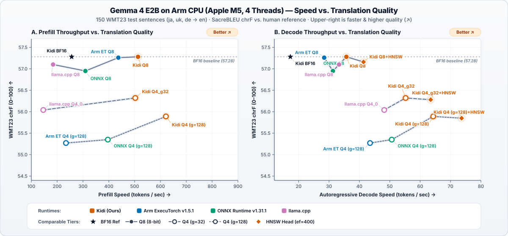
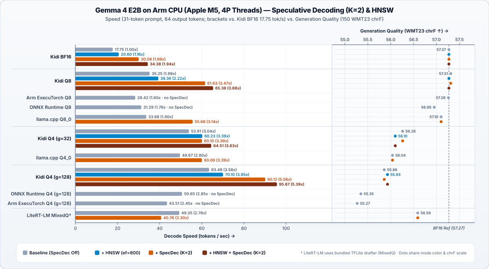

# Gemma 4 E2B on Arm CPU

This benchmark compares **Kidi** with Arm ExecuTorch, ONNX Runtime, and
`llama.cpp` on an Apple M5 CPU.

It answers three practical questions:

1. How fast are prompt prefill and autoregressive decode?
2. How much memory and model storage are required?
3. Does quantization preserve text generation quality?

## Setup

- **Model:** `google/gemma-4-E2B-it`
- **Hardware:** Apple M5 (`4P + 6E`), **4 performance CPU threads (`4P`)**, batch size 1
- **Speed:** 31-token prompt, 64 generated tokens, median of 3 runs after warm-up
- **Quality:** Text generation quality measured via translation on 150 WMT23 sentences (`63 ja->en`, `68 uk->en`, `19 de->en`) because of its well-established evaluation metrics
- **Prompt:** WMT26 translate-only system prompt plus an explicit user translation instruction
- **Decoding:** deterministic greedy decoding
- **Quality metric:** SacreBLEU chrF against human references

> **Threading note (`4P` portability vs. SoC-specific `4P + 2E`):** On this `4P + 6E` Apple M5, hardware profiling shows the 4-P-core cluster saturates a single cluster-to-memory port at `~84 GB/s`, whereas engaging both the P- and E-clusters (`4P + 2E`, 6 threads) reaches `~123 GB/s` (lifting `Kidi Q8` from `35.15` to `50.06 tok/s` decode and `567` to `739 tok/s` prefill). Because tuning thread counts to one SoC's cluster topology overfits to a specific chip, all systems here are benchmarked uniformly on **4 performance threads (`4P`)** (`QOS_CLASS_USER_INTERACTIVE` in Kidi, `--prio 2` in `llama.cpp`). When optimizing for a specific big.LITTLE SoC, pay attention to total cross-cluster decode memory bandwidth.

All rows originate from `google/gemma-4-E2B-it`.

vLLM is not included because its experimental
[Apple Silicon CPU backend](https://docs.vllm.ai/en/latest/getting_started/installation/cpu/)
currently supports FP32/FP16 only. Its KleidiAI-accelerated
[W4A8 path](https://docs.vllm.ai/en/latest/features/quantization/llm_compressor/int8_w4a8/)
targets Arm Linux, so it cannot produce a comparable Q8/Q4 result on this macOS
host. `vllm-metal` uses the Apple GPU and would be a different hardware
comparison.

## Results

| Runtime | Precision | Model (GiB) | Prefill (tok/s) | Decode (tok/s) | TTFT (ms) | Peak RSS (GiB) | chrF ↑ |
|---|---|---:|---:|---:|---:|---:|---:|
| **Kidi BF16** | BF16 | 8.50 | 306.66 | 17.93 | 101.09 | 5.22 | 57.27 |
| **Kidi Q8** | INT8 per-channel | 4.37 | 534.50 | 35.16 | 58.00 | 2.89 | 57.31 |
| **Kidi Q8 + HNSW** | INT8 per-channel | 4.42 | 582.26 | 40.77 | 53.24 | 2.60 | 57.27 |
| **Arm ExecuTorch Q8** | INT8 per-channel | 4.70 | 436.82 | 28.42 | 70.97 | 2.44 | 57.26 |
| **ONNX Runtime Q8** | INT8 per-channel | 4.69 | 309.40 | 31.29 | 100.19 | 2.25 | 56.95 |
| **llama.cpp Q8** | Q8_0 (g=32) | 4.61 | 184.33 | 33.30 | 168.17 | 6.58 | 57.10 |
| **Kidi Q4_g128** | Asymmetric Q4_g128 | 2.27 | 577.84 | 63.99 | 53.65 | 1.59 | 55.86 |
| **Kidi Q4_g128 + HNSW** | Asymmetric Q4_g128 | 2.32 | 639.56 | 73.31 | 48.47 | 1.61 | 55.93 |
| **Arm ExecuTorch Q4_g128** | Symmetric Q4_g128 | 2.39 | 234.11 | 43.51 | 132.42 | 1.84 | 55.27 |
| **ONNX Runtime Q4_g128** | Symmetric Q4_g128 | 2.41 | 396.27 | 50.65 | 78.23 | 1.45 | 55.35 |
| **Kidi Q4_g32** | Asymmetric Q4_g32 | 2.47 | 525.66 | 54.81 | 58.97 | 2.03 | 56.26 |
| **Kidi Q4_g32 + HNSW** | Asymmetric Q4_g32 | 2.52 | 534.61 | 62.79 | 57.99 | 1.92 | 56.10 |
| **llama.cpp Q4_0** | Q4_0 (g=32) | 2.47 | 146.19 | 48.17 | 212.05 | 4.87 | 56.04 |
| **Google LiteRT-LM MixedQ†** | INT2/INT4 mixed | 2.41 | 159.74 | 47.54 | 194.07 | 1.31 | 56.59 |

† Retained as a reference result, but not plotted: Google's available
`.litertlm` bundle uses a different mixed INT2/INT4 checkpoint rather than a
directly comparable Q8 or Q4 export.

<p align="center">
  
</p>

## Speculative Decoding (`K = 2`) & HNSW

Matched CPU comparison using `google/gemma-4-E2B-it-assistant` for
speculative decoding at a uniform look-ahead **`K = 2`** (Arm ExecuTorch and
ONNX Runtime have no Gemma 4 CPU speculative decoding runner). All speedups in
the table and chart below are relative to the **`Kidi BF16` baseline
(`17.75 tok/s = 1.00x`)**, and every speculative run matches its own baseline
greedy output token-for-token. For fair tuning: `llama.cpp` uses a
`Q8_0`-quantized assistant with CPU draft sampling, `Q8_0` draft KV,
`--spec-draft-p-min 0.4`, and `--prio 2` (`4P`); `llama.cpp BF16` (`3.50 tok/s`)
is omitted because `ggml` lacks fast Arm `BF16` CPU kernels (`F16` runs at
`17.38 tok/s` decode, matching `Kidi BF16`, though at `4.79 tok/s` prefill).
LiteRT-LM uses its bundled TFLite drafter (all tested runtime flags remain at
`25%` acceptance and slow decode down, matching why LiteRT-LM leaves speculative
decoding off by default).

| Variant | Base (tok/s) | + HNSW (tok/s) | + SpecDec K=2 (tok/s) | + HNSW + SpecDec (tok/s) | Speedup vs. Kidi BF16 | chrF (Base / HNSW) |
|---|---:|---:|---:|---:|---|---:|
| **Kidi BF16** | 17.75 | 20.60 | 30.08 | **34.38** | 1.00x / 1.16x / 1.69x / **1.94x** | 57.27 / 57.27 |
| **Kidi Q8** | 35.25 | 39.36 | 61.63 | **65.38** | 1.99x / 2.22x / 3.47x / **3.68x** | 57.31 / 57.27 |
| **Arm ExecuTorch Q8** | 28.42 | — | — | — | 1.60x | 57.26 / — |
| **ONNX Runtime Q8** | 31.29 | — | — | — | 1.76x | 56.95 / — |
| **llama.cpp Q8_0** *(tuned)* | 33.68 | — | 55.68 | — | 1.90x / — / 3.14x / — | 57.10 / — |
| **Kidi Q4_g128** | 63.48 | 70.10 | 90.12 | **95.67** | 3.58x / 3.95x / 5.08x / **5.39x** | 55.86 / 55.93 |
| **ONNX Runtime Q4_g128** | 50.65 | — | — | — | 2.85x | 55.35 / — |
| **Arm ExecuTorch Q4_g128** | 43.51 | — | — | — | 2.45x | 55.27 / — |
| **Kidi Q4_g32** | 53.91 | 60.23 | 60.10 | **64.51** | 3.04x / 3.39x / 3.39x / **3.63x** | 56.26 / 56.10 |
| **llama.cpp Q4_0** *(tuned)* | 49.67 | — | 60.09 | — | 2.80x / — / 3.39x / — | 56.04 / — |
| **Google LiteRT-LM MixedQ†** | 49.35 | — | 40.76 *(bundled)* | — | 2.78x / — / 2.30x / — | 56.59 / — |

<p align="center">
  
</p>

Assistant checkpoints are variant-specific (for example,
`google/gemma-4-E2B-it-assistant` for E2B) and run in FP32 via
[`speculative.py`](./speculative.py) or native CLI `--assistant-model LOCAL_DIRECTORY
--draft-tokens 2 --backend ynnpack --max-active 1` (`--hnsw` / `ef=800` for
HNSW).

## Runtime Binary Footprint

These Arm/macOS measurements were documented in November 2026, before
`kidi agent` was added. Current sizes vary with revision, platform, compiler,
and enabled features.

| Runtime | Artifacts Measured | Stripped (MiB) | Unstripped (MiB) | Notes |
|---|---|---:|---:|---|
| **Kidi (`kidi_android_baseline` / `kidi`)** | Single static binary (`kidi_android_baseline` / full `kidi` CLI) | **4.12 / 4.72** | 5.04 / 5.82 | Zero external non-OS dylibs; statically bundles C++ HF `tokenizer.json` + Jinja templates ([`tokenizerspp`](https://github.com/thammegowda/tokenizerspp) + `uni-algo`), SIMD image codecs ([`tahoma-vision`](https://github.com/thammegowda/tahoma-vision) + `libjpeg-turbo` + PNG/[`pigzpp`](https://github.com/thammegowda/pigzpp)/`zlib-ng`), WAV/Mel/vocoder audio, HNSW search, Metal kernels, and 6 model families |
| **llama.cpp (`llamacpp`)** | `llamacpp_gemma4_bench` + `libllama.0.dylib` + `libggml*.dylib` | **4.48** | 5.10 | C++ probe + GGML CPU/KleidiAI shared libraries (reads GGUF vocabulary) |
| **Arm ExecuTorch v1.5.1 (`arm`)** | `arm_gemma4_bench` (single static binary) | **7.87** | 10.30 | Zero external non-OS dylibs; ExecuTorch runtime + XNNPACK + KleidiAI (excludes tokenizer, vision/audio codecs, and checkpoint parsers) |
| **ONNX Runtime v1.31.1 (`onnx`)** | `libonnxruntime.1.31.1.dylib` | **20.10** | 31.51 | Standalone native ONNX Runtime C/C++ shared library (excludes Python interpreter and tokenizer) |
| **Google LiteRT-LM v0.17.1 (`litert`)** | `liblitert-lm.dylib` | **52.18** | 66.01 | Standalone native Google LiteRT-LM C++ shared library (excludes Python interpreter) |

## Key Takeaways

- **Q8:** Kidi provides the strongest overall speed/quality balance. The HNSW
  output head makes the decode benefit explicit while leaving the dense result
  available for an exact comparison.
- **Q4:** One representative `g=128` tier is retained. It compares Kidi directly
  with Arm ExecuTorch and ONNX Runtime. The `g=32` tier compares Kidi directly
  with llama.cpp Q4_0 at the same group size.
- **HNSW + Speculative Decoding (`K = 2`):** HNSW accelerates the 262k-token
  output projection and stacks cleanly with speculative decoding across all
  precisions: relative to `Kidi BF16` (`17.75 tok/s = 1.00x`), Kidi reaches
  **95.67 tok/s** (**5.39x**) on `Q4_g128`, **65.38 tok/s** (**3.68x**) on
  `Q8`, and **34.38 tok/s** (**1.94x**) on `BF16` (vs. `llama.cpp Q8_0` at
  `55.68 tok/s` / `3.14x`, `llama.cpp Q4_0` at `60.09 tok/s` / `3.39x`, and
  LiteRT-LM at `40.76 tok/s` / `2.30x`).

## Reproduce

The canonical values live in [`results.tsv`](./results.tsv). The runner renders
this page and [`docs/gemma4-arm-pareto.svg`](../../../docs/gemma4-arm-pareto.svg).
Temporary models, logs, and per-sentence outputs are written under `.cache/`.

```bash
# Q8 comparison
.cache/gemma-venv/bin/python benchmarks/gemma4/arm/run.py \
  --profile int8 \
  --work-dir .cache/benchmarks/arm-gemma4-int8 \
  --hnsw-index .cache/benchmarks/arm-gemma4/lm_head_ef800.hnsw \
  --include-onnx \
  --llamacpp-model .cache/benchmarks/arm-gemma4-int8/gemma4-e2b-q8_0.gguf \
  --litert-model tmp.models/gemma-4-E2B-it-litert-lm/gemma-4-E2B-it.litertlm \
  --eval-lines 150

# Q4 comparisons: g128 for Arm/ONNX and g32 for llama.cpp
.cache/gemma-venv/bin/python benchmarks/gemma4/arm/run.py \
  --profile int4-g128 \
  --work-dir .cache/benchmarks/arm-gemma4 \
  --hnsw-index .cache/benchmarks/arm-gemma4/lm_head_ef800.hnsw \
  --include-onnx --no-bf16 \
  --llamacpp-model .cache/benchmarks/arm-gemma4/gemma4-e2b-q4_0.gguf \
  --skip kidi \
  --eval-lines 150

# Refresh the public charts
.cache/gemma-venv/bin/python benchmarks/gemma4/arm/run.py \
  --render-svg docs/gemma4-arm-pareto.svg
python3 benchmarks/gemma4/arm/speculative.py \
  --render-svg docs/gemma4-arm-speculative.svg
```

Runtime-specific adapters remain beside the runner for reproducibility:
[`executorch_bench.cpp`](./executorch_bench.cpp),
[`onnx_bench.py`](./onnx_bench.py),
[`llamacpp_bench.cpp`](./llamacpp_bench.cpp), and
[`litert_bench.py`](./litert_bench.py).
