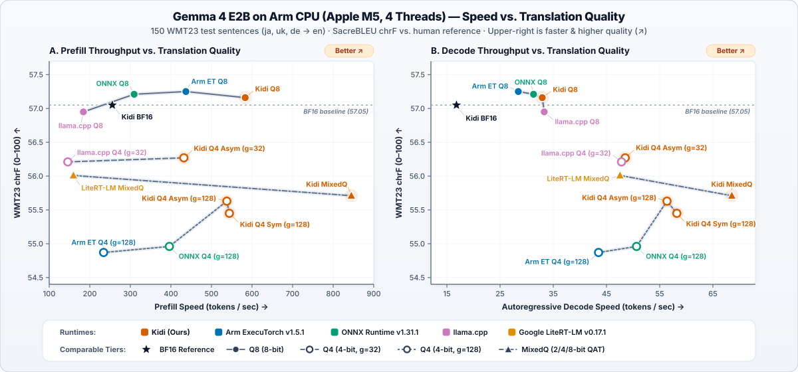

# Gemma 4 E2B on Arm CPU

This benchmark compares **Kidi** with Arm ExecuTorch, ONNX Runtime, and
`llama.cpp` on an Apple M5 CPU.

It answers three practical questions:

1. How fast are prompt prefill and autoregressive decode?
2. How much memory and model storage are required?
3. Does quantization preserve translation quality?

## Setup

- **Model:** `google/gemma-4-E2B-it`
- **Hardware:** Apple M5, 4 CPU threads, batch size 1
- **Speed:** 31-token prompt, 64 generated tokens, median of 3 runs after warm-up
- **Quality:** 150 WMT23 sentences (`63 ja->en`, `68 uk->en`, `19 de->en`)
- **Prompt:** WMT26 translate-only system prompt plus an explicit user translation instruction
- **Decoding:** deterministic greedy decoding
- **Quality metric:** SacreBLEU chrF against human references

All rows originate from `google/gemma-4-E2B-it`.

vLLM is not included because its experimental
[Apple Silicon CPU backend](https://docs.vllm.ai/en/latest/getting_started/installation/cpu/)
currently supports FP32/FP16 only. Its KleidiAI-accelerated
[W4A8 path](https://docs.vllm.ai/en/latest/features/quantization/llm_compressor/int8_w4a8/)
targets Arm Linux, so it cannot produce a comparable Q8/Q4 result on this macOS
host. `vllm-metal` uses the Apple GPU and would be a different hardware
comparison.

## Results

| Runtime | Precision | Model (GiB) | Prefill (tok/s) | Decode (tok/s) | TTFT (ms) | Peak RSS (GiB) | chrF ↑ |
|---|---|---:|---:|---:|---:|---:|---:|
| **Kidi BF16** | BF16 | 8.50 | 255.48 | 16.80 | 121.34 | 5.31 | 57.23 |
| **Kidi Q8** | INT8 per-channel | 4.37 | 490.67 | 34.11 | 63.18 | 2.83 | 57.48 |
| **Kidi Q8 + HNSW** | INT8 per-channel | 4.42 | 525.83 | 39.01 | 58.95 | 2.34 | 57.41 |
| **Arm ExecuTorch Q8** | INT8 per-channel | 4.70 | 436.82 | 28.42 | 70.97 | 2.44 | 57.26 |
| **ONNX Runtime Q8** | INT8 per-channel | 4.69 | 309.40 | 31.29 | 100.19 | 2.25 | 56.95 |
| **llama.cpp Q8** | Q8_0 (g=32) | 4.61 | 184.33 | 33.30 | 168.17 | 6.58 | 57.10 |
| **Kidi Q4_g128** | Asymmetric Q4_g128 | 2.27 | 558.71 | 60.31 | 55.49 | 1.47 | 56.19 |
| **Kidi Q4_g128 + HNSW** | Asymmetric Q4_g128 | 2.32 | 535.99 | 67.32 | 57.84 | 1.56 | 56.22 |
| **Arm ExecuTorch Q4_g128** | Symmetric Q4_g128 | 2.39 | 234.11 | 43.51 | 132.42 | 1.84 | 55.27 |
| **ONNX Runtime Q4_g128** | Symmetric Q4_g128 | 2.41 | 396.27 | 50.65 | 78.23 | 1.45 | 55.35 |
| **Kidi Q4_g32** | Asymmetric Q4_g32 | 2.47 | 508.14 | 52.18 | 61.01 | 1.92 | 56.46 |
| **Kidi Q4_g32 + HNSW** | Asymmetric Q4_g32 | 2.52 | 513.49 | 58.88 | 60.37 | 1.93 | 56.38 |
| **llama.cpp Q4_0** | Q4_0 (g=32) | 2.47 | 146.19 | 48.17 | 212.05 | 4.87 | 56.04 |
| **Google LiteRT-LM MixedQ†** | INT2/INT4 mixed | 2.41 | 159.74 | 47.54 | 194.07 | 1.31 | 56.59 |

† Retained as a reference result, but not plotted: Google's available
`.litertlm` bundle uses a different mixed INT2/INT4 checkpoint rather than a
directly comparable Q8 or Q4 export.

<p align="center">
  
</p>

## Key Takeaways

- **Q8:** Kidi provides the strongest overall speed/quality balance. The HNSW
  output head makes the decode benefit explicit while leaving the dense result
  available for an exact comparison.
- **Q4:** One representative `g=128` tier is retained. It compares Kidi directly
  with Arm ExecuTorch and ONNX Runtime. The `g=32` tier compares Kidi directly
  with llama.cpp Q4_0 at the same group size.
- **HNSW:** HNSW accelerates the large 262k-token output projection, so its
  primary benefit is decode speed rather than transformer prefill.

## Reproduce

The canonical values live in [`results.tsv`](./results.tsv). The runner renders
this page and [`docs/gemma4-arm-pareto.svg`](../../../docs/gemma4-arm-pareto.svg).
Temporary models, logs, and per-sentence outputs are written under `.cache/`.

```bash
# Q8 comparison
.cache/gemma-venv/bin/python benchmarks/gemma4/arm/run.py \
  --profile int8 \
  --work-dir .cache/benchmarks/arm-gemma4-int8 \
  --hnsw-index .cache/benchmarks/arm-gemma4/lm_head_ef800.hnsw \
  --include-onnx \
  --llamacpp-model .cache/benchmarks/arm-gemma4-int8/gemma4-e2b-q8_0.gguf \
  --litert-model tmp.models/gemma-4-E2B-it-litert-lm/gemma-4-E2B-it.litertlm \
  --eval-lines 150

# Q4 comparisons: g128 for Arm/ONNX and g32 for llama.cpp
.cache/gemma-venv/bin/python benchmarks/gemma4/arm/run.py \
  --profile int4-g128 \
  --work-dir .cache/benchmarks/arm-gemma4 \
  --hnsw-index .cache/benchmarks/arm-gemma4/lm_head_ef800.hnsw \
  --include-onnx --no-bf16 \
  --llamacpp-model .cache/benchmarks/arm-gemma4/gemma4-e2b-q4_0.gguf \
  --skip kidi \
  --eval-lines 150

# Refresh the public chart
.cache/gemma-venv/bin/python benchmarks/gemma4/arm/run.py \
  --render-svg docs/gemma4-arm-pareto.svg
```

Runtime-specific adapters remain beside the runner for reproducibility:
[`executorch_bench.cpp`](./executorch_bench.cpp),
[`onnx_bench.py`](./onnx_bench.py),
[`llamacpp_bench.cpp`](./llamacpp_bench.cpp), and
[`litert_bench.py`](./litert_bench.py).
